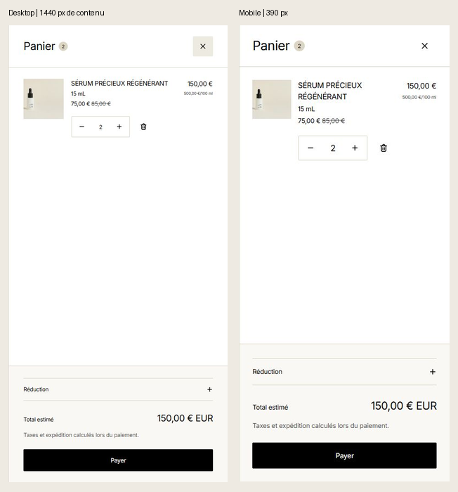

# Panier — cohérence avec la fiche produit

**25 octobre 2026.** Le panier natif Horizon reprend désormais les choix visuels de la page Maison Célestine. Ce travail répond à la demande de cohérence du candidat ; aucune composition de panier supplémentaire n’a été inventée à partir de Figma.

Le thème **KNR - Preview, 189290447076**, reste non publié. Aucun commit ni envoi de candidature.

## Présentation

| Élément | Avant | Après |
| --- | --- | --- |
| Typographie | Inter du thème natif, titre en gras | Inter auto-hébergée de la fiche, graisse 400 et approche cohérente |
| Titre Panier | 24 px, gras, interligne 24 px | 24 / 32 px, régulier, approche −0,48 px |
| Produit | 16 px en casse mixte | 14 / 20 px, capitales et approche −0,28 px, comme la barre d’achat |
| Couleurs | Blanc et gris natifs | Blanc, encre, papier `#F9F8F5` et sable `#DCD5C3`, issus des réglages KNR |
| Total et validation | Petit total, bouton arrondi de 14 px | Total 20 / 28 px régulier ; bouton noir 48 px, rayon 2 px et texte 13 / 21 px |
| Quantité et fermeture | Petits contrôles, fermeture circulaire avec ombre | Contrôles fins à faible rayon ; boutons de quantité, suppression et fermeture de 44 × 44 px |
| Formulaire de réduction | Rayons et police natifs | Rayons 2 px, soulignement chaud au focus et survol cohérent avec les accordéons |
| Panier vide | Habillage Horizon | Même titre régulier et bouton noir que la fiche, lien natif de reprise des achats |

Les champs sont en 16 px sur mobile et les contrôles restent nommés et accessibles au clavier. Les textes de prix, variantes, remises, taxes, liens de compte et destination de paiement restent natifs Shopify. Les prix et contenus convenus ne changent pas.

## Intégration

Le snippet `knr-cart-styles.liquid` est rendu par le layout `knr`. Ses sélecteurs sont limités à `.knr-page #cart-drawer` ; les pages d’accompagnement natives conservent leur présentation. Les couleurs et leurs composantes RGB restent synchronisées avec les réglages KNR. La mise en forme reste présente après les mises à jour Ajax et l’alternance panier vide/rempli.

La superposition modale et le panier natif sont conservés. Le contenu derrière le tiroir garde sa largeur de 1440 px pendant l’ouverture et la fermeture.

## Correctif de focus identifié pendant la recette

La suppression du dernier article dans Horizon remplaçait le contenu puis laissait le focus sur le document. Le correctif d’assemblage restaure le focus sur **Fermer** après l’affichage optimiste du panier vide et après le rendu confirmé par Shopify. Il agit uniquement si le panier KNR est modal, vide et sans autre contrôle encore focalisé. Il ne vole pas le focus d’un champ existant ou d’un panier fermé.

Le correctif est appliqué à `assets/component-cart-items.js` par `scripts/patch-cart-overlay.mjs`, avec vérification des points d’application sur la base Horizon 4.3.0. Aucun écouteur, minuteur ou appel réseau supplémentaire. L’assemblage neuf et la syntaxe du fichier natif généré ont été vérifiés ; le code natif complet n’est pas ajouté au dépôt public.

## Vérifications observées

- Desktop : fonte KNR Inter, titre 24 / 32 px régulier, CTA 13 / 21 px de 48 px, rayon 2 px, fond papier du récapitulatif et bordures sable.
- Largeurs de contenu 320, 375, 390, 768, 1024, 1440 et 1920 px. Aucun débordement horizontal du tiroir ou des contrôles mesurés. À 320 × 568 px, les articles défilent et le paiement reste dans la fenêtre.
- Panier mixte : sérum avec prix unitaire et huile sans prix unitaire ; titres, variantes, prix, quantités et suppression correctement disposés.
- Quantité 2 → 3 → 2 : totaux confirmés 150 → 225 → 150 €. Mise en forme conservée après actualisation.
- Code de test invalide : message d’erreur natif visible, total inchangé et aucun code appliqué.
- Suppression d’articles, panier vide puis nouvel ajout : contrôles et habillage conservés. Après suppression du dernier article, focus effectivement observé sur Fermer après la réponse serveur ; Tab atteint ensuite le lien de connexion dans le tiroir.
- Focus clavier visible sur les boutons ; soulignement chaud du champ. En couleurs forcées, contour système de 2 px. En réduction des mouvements, animation du tiroir et transitions des contrôles désactivées. Survol du CTA identique à celui de la fiche, sans changement de hauteur.
- Échap et clic sur le fond vérifiés après la fin de la transition native. Aucun redimensionnement du contenu derrière le tiroir.
- État initial restauré : **deux unités de 15 mL, total 150 €**, sans remise. Aucune commande passée.

`npm run check` est réussi : JavaScript, contenu, tests existants et format. Theme Check : **0 erreur et 2 avertissements natifs Horizon existants**. `node --check` valide aussi le composant panier natif généré. Aucun nouveau score Lighthouse ou essai Safari/iPhone réel n’est annoncé. Les essais mobiles sont effectués dans Chrome avec émulation tactile.

Les observations effectuées pendant les transitions natives d’ouverture/fermeture ne servent pas aux relevés finaux de géométrie. Les essais antérieurs au correctif de focus sont distingués des résultats finaux dans les preuves.

## Preuves

[Relevés et tests](final-validation/cart-style/checks.json) · [Desktop](final-validation/cart-style/desktop-after.png) · [Mobile](final-validation/cart-style/mobile-after.png) · [320 px, faible hauteur](final-validation/cart-style/mobile-320-short.png) · [Panier mixte](final-validation/cart-style/mobile-mixed.png) · [Focus du panier vide](final-validation/cart-style/empty-focus.png)

