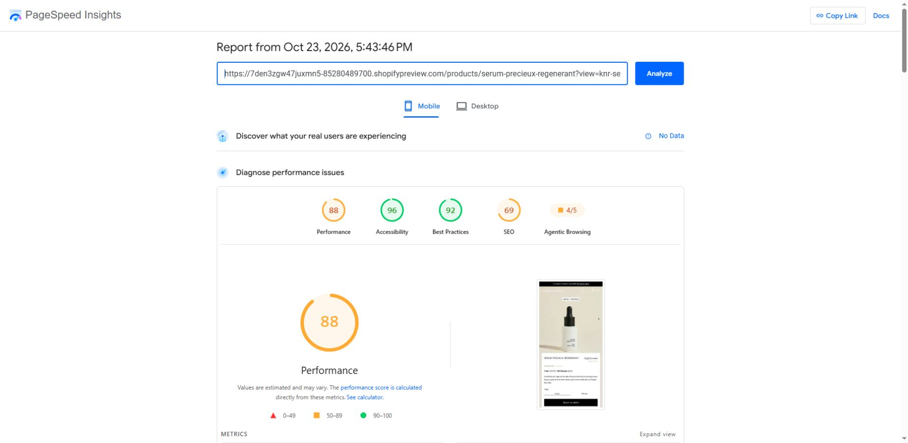
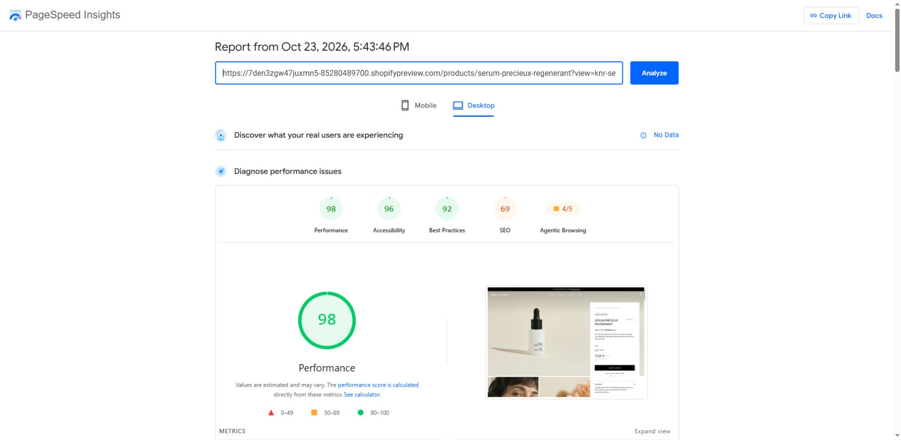
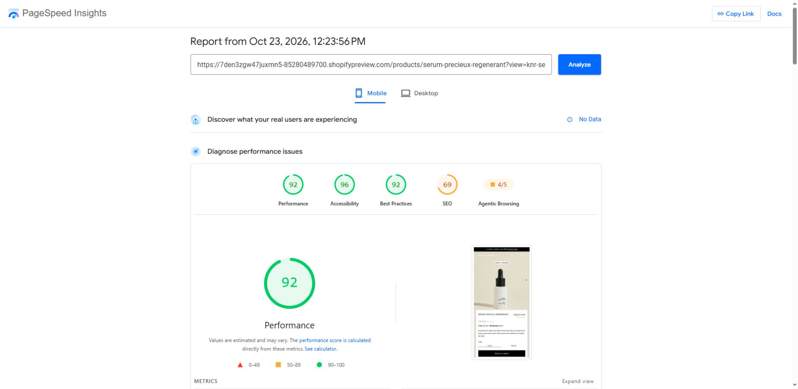
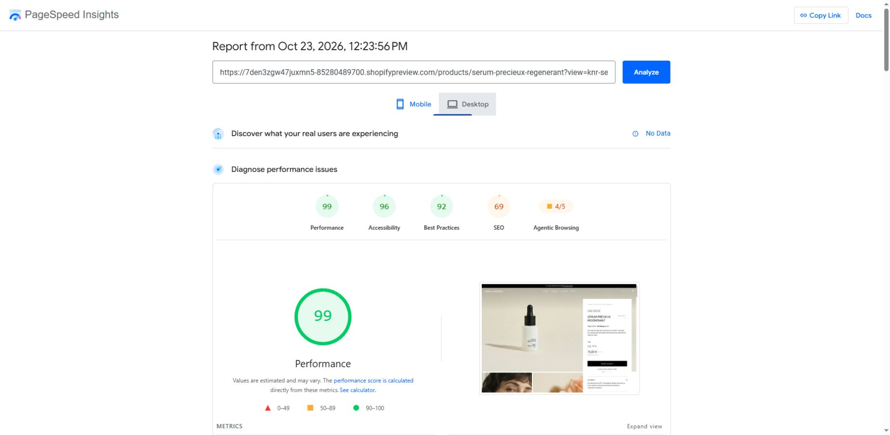

# Audit Lighthouse via Google PageSpeed Insights

**Portée temporelle :** ces mesures précèdent la correction administrative de disponibilité internationale, le [correctif du menu mobile](MENU-MOBILE.md) et la [cible tactile d’ajout rapide](AJOUT-RAPIDE-TACTILE.md) du 26 octobre. Ces compléments modifient le module JavaScript et les styles du header, puis les styles de la section produit. Aucun score postérieur à ces changements n’est annoncé ici.

Elles précèdent également l’[harmonisation des transitions du menu et du panier](TRANSITIONS-TIROIRS.md), qui modifie leurs styles et le correctif natif assemblé du panier. Ce réglage n’a pas de nouveau score mesuré.

L’[ajout de la flèche précédente mobile](GALERIE-MOBILE.md) intervient ensuite. Il réutilise le SVG existant et modifie la section produit, le module commun et les libellés de locales ; aucun score postérieur à ce correctif n’est disponible.

Les [transitions des détails produit et de la FAQ](ACCORDIONS.md), ajoutées ensuite, sont déclenchées uniquement à l’interaction. Elles modifient deux sections et le module commun, avec un nouveau propriétaire de styles. Les mesures ci-dessous ne constituent pas un audit postérieur à ce complément.

Le [correctif de focus tactile du panier](FOCUS-PANIER.md) intervient ensuite sur le module commun, le layout et les styles du panier. Il a une confirmation réelle sur iPhone Chrome pour les deux parcours signalés, mais aucun nouveau score PageSpeed.

## Nouvelle mesure du brouillon — 26 octobre 2026

Le nouveau lien visiteur fourni par le candidat a permis **trois analyses indépendantes par profil**, entre 08:58 et 09:01, heure de Tunis. La page auditée est bien le sérum et sa mise en page KNR, pas la page de mot de passe. Le thème **189290447076 reste non publié**, les animations et survols restent actifs ; aucun code, réglage marchand, mot de passe ou état de stock n’a été modifié pour ces mesures.

| Médiane des trois mesures du matin | Mobile | Ordinateur |
| --- | ---: | ---: |
| Performance | **81** | **98** |
| Plage de performance observée | 68–90 | 96–98 |
| Accessibilité automatique | 96 | 96 |
| Bonnes pratiques | 92 | 92 |
| SEO | 69 | 69 |
| FCP | 2,138 s | 0,561 s |
| LCP | 4,632 s | 1,098 s |
| TBT | 28 ms | 58 ms |
| CLS | 0 | 0 |

| Mesure | Performance | FCP | LCP | TBT | CLS | Rapport |
| --- | ---: | ---: | ---: | ---: | ---: | --- |
| Ordinateur 1 | 98 | 0.561 s | 1.068 s | 15 ms | 0 | [Google](https://pagespeed.web.dev/analysis/https-38mjaon6zx1j18jh-85280489700-shopifypreview-com-products-serum-precieux-regenerant/pook45h0ki?form_factor=desktop) |
| Mobile 1 | 81 | 2.138 s | 4.632 s | 15 ms | 0 | [Google](https://pagespeed.web.dev/analysis/https-38mjaon6zx1j18jh-85280489700-shopifypreview-com-products-serum-precieux-regenerant/pook45h0ki?form_factor=mobile) |
| Ordinateur 2 | 96 | 0.573 s | 1.098 s | 111 ms | 0 | [Google](https://pagespeed.web.dev/analysis/https-38mjaon6zx1j18jh-85280489700-shopifypreview-com-products-serum-precieux-regenerant/5x6qo8xpb8?form_factor=desktop) |
| Mobile 2 | 90 | 2.132 s | 3.301 s | 28 ms | 0 | [Google](https://pagespeed.web.dev/analysis/https-38mjaon6zx1j18jh-85280489700-shopifypreview-com-products-serum-precieux-regenerant/5x6qo8xpb8?form_factor=mobile) |
| Ordinateur 3 | 98 | 0.560 s | 1.100 s | 58 ms | 0 | [Google](https://pagespeed.web.dev/analysis/https-38mjaon6zx1j18jh-85280489700-shopifypreview-com-products-serum-precieux-regenerant/td69f8caj5?form_factor=desktop) |
| Mobile 3 | 68 | 3.429 s | 5.689 s | 39 ms | 0 | [Google](https://pagespeed.web.dev/analysis/https-38mjaon6zx1j18jh-85280489700-shopifypreview-com-products-serum-precieux-regenerant/td69f8caj5?form_factor=mobile) |

**Le résultat mobile reste un point ouvert de performance.** Il est inférieur à la dernière paire du 23 octobre (92/98) et à la médiane mobile antérieure (88). Aucun résultat n’est écarté pour améliorer la synthèse. L’ordinateur reste stable à une médiane de 98 ; le meilleur mobile à 90 n’est pas présenté comme une performance constante.

### Diagnostic et portée

Le LCP est l’image principale du sérum, toujours servie par un picture responsive avec `loading="eager"` et `fetchpriority="high"`. Le premier essai mobile donne un LCP de 4,632 s ; le troisième monte à 5,689 s. Dans les sous-parties du relevé de trace, le délai de rendu de cette image passe de **240 ms à 2 030 ms**, tandis que le temps jusqu’au premier octet passe de 210 à 50 ms. Il serait donc inexact d’attribuer tout l’écart au serveur ou au poids de l’image. Les valeurs de ces sous-parties de trace ne s’additionnent pas aux métriques de la simulation Slow 4G.

Le JavaScript reste peu bloquant (15, 28 et 39 ms sur mobile) et le CLS reste nul. Les apparitions éditoriales excluent explicitement le hero et les informations d’achat. Ces faits **ne démontrent pas une causalité des animations**, ni leur absence absolue d’effet : les six analyses présentes gardent le réglage actif et ne constituent pas une nouvelle comparaison A/B.

Les audits développés signalent toujours les styles bloquants, environ 68,1 Kio dans le premier relevé (57,0 Kio compilés Shopify, 7,7 Kio Horizon et 3,4 Kio KNR), avec une économie estimée de 360 ms. Les styles natifs et les fonctions panier ne sont pas retirés pour faire monter un score. Aucune modification de chargement n’est justifiée et validée par cette passe ; une optimisation plus poussée demanderait une hypothèse isolée et une nouvelle vérification visuelle/fonctionnelle.

Accessibilité 96 : les contrastes Figma restent signalés conformément à la décision du candidat. Bonnes pratiques 92 et SEO 69 gardent les mêmes familles de réserves, dont le blocage d’indexation du domaine temporaire. L’absence de données CrUX reste explicite : ces résultats ne valident pas les Core Web Vitals terrain ni un appareil iOS réel.

Méthode : interface Google PageSpeed Insights, Lighthouse 13.5.0, HeadlessChromium 153.0.8010.36 ; mobile Moto G Power émulé/Slow 4G et ordinateur/profil personnalisé de Google. Le paramètre officiel `pb=0` retire la barre Shopify. Les répétitions 2 et 3 utilisent un paramètre neutre `knr_audit` distinct, comme les mesures historiques ; les contenus et le code restent identiques. Les valeurs exactes proviennent des liens du calculateur visibles dans les rapports et les captures conservent les valeurs arrondies de l’interface.

Dans la session du domaine temporaire au moment des mesures, Liquid rendait les deux variantes indisponibles avec France affiché comme région de repli. Ce problème a ensuite été reproduit sur l’iPhone du candidat et corrigé dans les marchés et les profils d’expédition. Les ajouts serveur fonctionnent depuis la Tunisie, la France et les États-Unis ; le candidat a confirmé les deux tailles et le panier sur iPhone. Voir [le correctif et ses preuves](DISPONIBILITE-INTERNATIONALE.md). **Les six mesures ci-dessus précèdent cette correction administrative** : le code du thème est identique, mais le rendu du sélecteur contient désormais 237 pays/régions. Aucun score postérieur au correctif n’est annoncé.

[Six relevés structurés](final-validation/pagespeed-20261026/results.json) · [Diagnostic mobile 1](final-validation/pagespeed-20261026/run-1-mobile-diagnostics.txt) · [Diagnostic mobile 3](final-validation/pagespeed-20261026/run-3-mobile-diagnostics.txt) · [Capture mobile 1](final-validation/pagespeed-20261026/run-1-mobile.png) · [Capture mobile 2](final-validation/pagespeed-20261026/run-2-mobile.png) · [Capture mobile 3](final-validation/pagespeed-20261026/run-3-mobile.png) · [Capture ordinateur 3](final-validation/pagespeed-20261026/run-3-desktop.png).

Le lien visiteur expire après deux jours ; il sert à cette recette, pas à remplacer silencieusement le lien durable de soumission. Aucune publication, aucun commit ni commande effectués.

## Historique du 23 octobre

Les mesures ci-dessous décrivent des états et conditions antérieurs. Elles sont conservées pour comparaison et ne remplacent pas les résultats du 26 octobre ci-dessus.

23 octobre 2026 — thème **KNR - Preview**, `189290447076`, toujours **non publié**. Mot de passe inchangé ; zéro commit.

## Vérification ordinateur / mobile après tous les derniers retours — 19 h 47

Une nouvelle analyse de la même version donne **98 sur ordinateur et 92 sur mobile**, avec les apparitions au défilement, les survols et le carrousel actifs. La capture fournie par le candidat à 97 montre la mise en page ordinateur ; elle ne doit pas être comparée directement aux mesures mobiles à 86–90. Aucun changement de code ou de réglage n'a été nécessaire pour retrouver ce niveau sur ordinateur.

| Profil | Performance | FCP | LCP | TBT | CLS | Rapport |
| --- | ---: | ---: | ---: | ---: | ---: | --- |
| Ordinateur | 98 | 0,526 s | 1,001 s | 0 ms | 0 | [Google](https://pagespeed.web.dev/analysis/https-7den3zgw47juxmn5-85280489700-shopifypreview-com-products-serum-precieux-regenerant/bz0q3k3etz?form_factor=desktop) |
| Mobile | 92 | 1,981 s | 3,151 s | 33 ms | 0 | [Google](https://pagespeed.web.dev/analysis/https-7den3zgw47juxmn5-85280489700-shopifypreview-com-products-serum-precieux-regenerant/bz0q3k3etz?form_factor=mobile) |

Il s'agit d'une mesure par profil, pas d'une nouvelle médiane ni d'un gain de code. La variabilité observée dans les [six essais avec/sans animations](PERFORMANCE-ANIMATIONS.md) reste valable. Le LCP mobile garde une marge d'amélioration. La revue du chargement confirme la priorité haute et le chargement immédiat de l'image principale, le préchargement de la police principale et le chargement différé du module. Les styles nécessaires au premier rendu et les fonctions natives Shopify sont conservés. Boutique protégée, thème non publié et aucun commit.

[Résultats et métriques exactes](final-validation/desktop-mobile-comparison/results.json) · [Capture ordinateur](final-validation/desktop-mobile-comparison/desktop.png) · [Capture mobile](final-validation/desktop-mobile-comparison/mobile.png).

## Mesures de la revue générale après animations et survols — 23 octobre 2026

Ces mesures remplacent les scores de synthèse précédents. Le thème de brouillon et ses animations sont actifs ; les effets de survol sont chargés. Trois nouveaux rapports indépendants utilisent `knr_audit=final-motion-hover-1`, `-2`, `-3`, avec `pb=0`. Le mot de passe reste actif et le thème n’est pas publié.

| Médiane de trois mesures | Mobile | Ordinateur |
| --- | ---: | ---: |
| Performance | **88** | **98** |
| Accessibilité automatique | **96** | **96** |
| Bonnes pratiques | **92** | **92** |
| SEO | **69** | **69** |
| FCP | 2,303 s | 0,532 s |
| LCP | 3,301 s | 0,941 s |
| TBT | 39 ms | 71 ms |
| CLS | 0 | 0 |

| Mesure | Performance | FCP | LCP | TBT | CLS | Rapport |
| --- | ---: | ---: | ---: | ---: | ---: | --- |
| mobile 1 | 88 | 2.348 s | 3.451 s | 22 ms | 0 | [Google](https://pagespeed.web.dev/analysis/https-7den3zgw47juxmn5-85280489700-shopifypreview-com-products-serum-precieux-regenerant/jnuj12ttox?form_factor=mobile) |
| desktop 1 | 98 | 0.532 s | 0.941 s | 71 ms | 0 | [Google](https://pagespeed.web.dev/analysis/https-7den3zgw47juxmn5-85280489700-shopifypreview-com-products-serum-precieux-regenerant/jnuj12ttox?form_factor=desktop) |
| mobile 2 | 90 | 2.191 s | 3.301 s | 39 ms | 0 | [Google](https://pagespeed.web.dev/analysis/https-7den3zgw47juxmn5-85280489700-shopifypreview-com-products-serum-precieux-regenerant/64oph2gy2u?form_factor=mobile) |
| desktop 2 | 99 | 0.525 s | 0.820 s | 13 ms | 0 | [Google](https://pagespeed.web.dev/analysis/https-7den3zgw47juxmn5-85280489700-shopifypreview-com-products-serum-precieux-regenerant/64oph2gy2u?form_factor=desktop) |
| mobile 3 | 88 | 2.303 s | 3.301 s | 145 ms | 0 | [Google](https://pagespeed.web.dev/analysis/https-7den3zgw47juxmn5-85280489700-shopifypreview-com-products-serum-precieux-regenerant/0mwy9awbah?form_factor=mobile) |
| desktop 3 | 98 | 0.557 s | 0.941 s | 101 ms | 0 | [Google](https://pagespeed.web.dev/analysis/https-7den3zgw47juxmn5-85280489700-shopifypreview-com-products-serum-precieux-regenerant/0mwy9awbah?form_factor=desktop) |

La médiane mobile passe de 92 à 88, celle de l’ordinateur de 99 à 98. Les plages actuelles sont 88–90 et 98–99, contre 86–93 et 97–99 précédemment. La variabilité ne permet pas d’attribuer cet écart aux animations : aucune comparaison isolée interrupteur activé/désactivé n’avait encore été réalisée à ce stade. La comparaison ultérieure est consignée dans [PERFORMANCE-ANIMATIONS.md](PERFORMANCE-ANIMATIONS.md). Le TBT médian est plus bas (39/71 ms contre 62/82 ms), le CLS reste nul et le LCP mobile demeure à améliorer. Ces résultats ne sont pas présentés comme une amélioration du score global.

Le [diagnostic développé](final-validation/final-review/pagespeed-diagnostics.txt) identifie environ 300 ms d’économie potentielle dans les styles bloquants : 56,0 Kio pour les styles compilés Shopify, 7,7 Kio pour la base Horizon et 3,2 Kio pour la base KNR. L’image LCP est bien l’image produit, avec `loading="eager"` et `fetchpriority="high"`. Les styles nécessaires au premier rendu et aux composants natifs sont conservés : les différer sans CSS critique provoquerait un rendu non stylé. Voir les recommandations [Shopify sur le CSS critique](https://shopify.dev/docs/storefronts/themes/best-practices/performance/load-critical-css-synchronously).

Aucun nouvel échec d’accessibilité noté n’apparaît : la réserve de contraste Figma persiste, conformément à la décision du candidat. Les cibles de l’ajout rapide et des filtres ne réintroduisent pas d’échec de taille/espacement. SEO 69 correspond toujours à la protection d’indexation de l’aperçu. Aucune protection Shopify n’est supprimée pour modifier le score.

Lighthouse mesure le chargement, pas la fluidité de tout un parcours de défilement. Les interactions, cartes horizontales, apparitions terminées et mouvement réduit sont vérifiés séparément en Chrome ; aucun chiffre FPS, résultat Safari réel ou Core Web Vitals terrain n’est revendiqué.

[Résultats structurés](final-validation/final-review/pagespeed-results.json) · [Recette finale](REVUE-FINALE.md)

## Historique avant les derniers retours de revue

Les mesures et corrections ci-dessous décrivent l’état antérieur. L’ancien lien unique de recommandation a depuis été remplacé par une image liée au produit et un bouton d’ajout rapide indépendant, à la demande du candidat ; voir [retours de revue](RETOURS-REVUE.md).

### Résultats initiaux

| Médiane de trois mesures | Mobile | Ordinateur |
| --- | ---: | ---: |
| Performance | **92** | **99** |
| Accessibilité automatique | **96** | **96** |
| Bonnes pratiques | **92** | **92** |
| SEO | **69** | **69** |
| FCP | 2,014 s | 0,534 s |
| LCP | 3,151 s | 0,961 s |
| TBT | 62 ms | 82 ms |
| CLS | 0 | 0 |

| Mesure | Performance | FCP | LCP | TBT | CLS | Source |
| --- | ---: | ---: | ---: | ---: | ---: | --- |
| mobile 1 | 93 | 2.014 s | 2.851 s | 62 ms | 0 | [Rapport Google](https://pagespeed.web.dev/analysis/https-7den3zgw47juxmn5-85280489700-shopifypreview-com-products-serum-precieux-regenerant/8s0rbt66jf?form_factor=mobile) |
| desktop 1 | 97 | 0.534 s | 0.997 s | 103 ms | 0 | [Rapport Google](https://pagespeed.web.dev/analysis/https-7den3zgw47juxmn5-85280489700-shopifypreview-com-products-serum-precieux-regenerant/8s0rbt66jf?form_factor=desktop) |
| mobile 2 | 92 | 1.991 s | 3.151 s | 51 ms | 0 | [Rapport Google](https://pagespeed.web.dev/analysis/https-7den3zgw47juxmn5-85280489700-shopifypreview-com-products-serum-precieux-regenerant/s5megzo5q4?form_factor=mobile) |
| desktop 2 | 99 | 0.536 s | 0.901 s | 82 ms | 0 | [Rapport Google](https://pagespeed.web.dev/analysis/https-7den3zgw47juxmn5-85280489700-shopifypreview-com-products-serum-precieux-regenerant/s5megzo5q4?form_factor=desktop) |
| mobile 3 | 86 | 2.274 s | 3.451 s | 164 ms | 0 | [Rapport Google](https://pagespeed.web.dev/analysis/https-7den3zgw47juxmn5-85280489700-shopifypreview-com-products-serum-precieux-regenerant/3iua9h8gf9?form_factor=mobile) |
| desktop 3 | 99 | 0.532 s | 0.961 s | 56 ms | 0 | [Rapport Google](https://pagespeed.web.dev/analysis/https-7den3zgw47juxmn5-85280489700-shopifypreview-com-products-serum-precieux-regenerant/3iua9h8gf9?form_factor=desktop) |

Chaque médiane est calculée séparément sur les trois mesures de sa colonne. Les scores mobiles vont de 86 à 93 ; les scores ordinateur de 97 à 99. Un seul meilleur score n'est pas présenté comme un résultat constant. Le LCP mobile médian reste au-dessus de 2,5 s : une amélioration reste possible malgré le score global vert. Les feuilles CSS natives du thème figurent parmi les requêtes bloquant le rendu ; elles restent nécessaires aux composants Horizon réutilisés.

## Méthode et limites

- Lighthouse **13.5.0**, HeadlessChromium **153.0.8010.36**, depuis l'interface Google PageSpeed Insights. Mobile : Moto G Power émulé et connexion lente 4G ; ordinateur : profil desktop de Google.
- URL visiteur Shopify du candidat, chemin du produit et `view=knr-serum`. Paramètre officiel `pb=0` pour retirer la barre d'aperçu du périmètre d'audit. Les captures montrent bien le sérum et sa mise en page personnalisée.
- Les deux répétitions initiales ayant rendu exactement les mêmes métriques ont été écartées. Les répétitions retenues utilisent un paramètre de mesure `knr_audit` distinct, sans effet sur le contenu, pour obtenir de nouveaux résultats.
- Le test initial de l'URL `myshopify.com` avait audité la **page de mot de passe** : son score 98 est exclu. Le premier test visiteur avec barre d'aperçu donnait 80, puis 89 sans barre avant corrections tactiles. Ces essais ne sont pas mélangés aux trois mesures finales.
- Les tentatives locales décrites auparavant restent un historique d'échec ; la réserve « aucun résultat Lighthouse » est maintenant levée. L'API publique sans clé a répondu 429 : les preuves conservées sont les relevés de l'interface et captures Google, pas un export JSON brut de Lighthouse.
- Aucune donnée CrUX : aucune validation des Core Web Vitals réels ou de l'INP n'est revendiquée. Refaire le contrôle de l'URL finale après publication approuvée. Le lien visiteur expire après deux jours.

## Corrections et réserves

1. **Liens de recommandations superposés** : l'image et le symbole « + » partagent désormais un lien unique. Même apparence et même destination ; une seule cible tactile sur l'image. Navigation vers Huile Précieuse vérifiée.
2. **Filtres de notes mobiles** : cibles de 24 px, sans chevauchement. Le groupe gagne 18 px de hauteur. À 390 px, le filtre quatre étoiles affiche les deux avis attendus, sans débordement. Les nouveaux rapports ne signalent plus la règle de taille/espacement des cibles.
3. **Contraste** : le candidat a confirmé la conservation des teintes fournies dans Figma. Les contrastes insuffisants sont documentés comme limites de la maquette ; aucune modification de couleur n'est prévue dans le périmètre de l'exercice. Le score 96 ne constitue pas une conformité globale WCAG AA.
4. **Bonnes pratiques 92** : les erreurs signalées concernent les métriques Shopify bloquées, un chemin de pixel Shopify en 404 et le cadre Shop.app refusé par sa CSP sur le domaine temporaire. Les protections Shopify n'ont pas été supprimées pour faire monter le score.
5. **SEO 69** : les neuf autres audits notés passent ; le seul échec est le blocage d'indexation de l'aperçu (`noindex,nofollow` et `robots.txt`). Le détail et l'amélioration éditoriale sont consignés ci-dessous. L'avertissement non noté sur les liens « Mon compte » vient des destinations relative/absolue sur le domaine temporaire ; leurs libellés sont identiques.

Les contrôles de syntaxe, contenu, formatage et Theme Check passent : **0 erreur, 2 avertissements natifs Horizon inchangés**. La publication, le commit et l'envoi de candidature restent en attente de revue. Safari/iOS reste non vérifié.

## Vérification SEO détaillée du 23 octobre

Le rapport Google mobile 2 a été rouvert et tous les audits SEO ont été développés. Les neuf contrôles suivants passent : titre, méta-description, réponse HTTP, libellés de liens, liens explorables, syntaxe de `robots.txt`, attributs alternatifs des images, `hreflang` et URL canonique. Un contrôle indiqué comme réussi ne remplace pas une revue éditoriale complète.

Le seul audit SEO noté en échec est **Page is blocked from indexing**. Le rapport montre deux directives sur le domaine visiteur temporaire : `<meta name="robots" content="noindex,nofollow" />` et `robots.txt`, ligne 4. Dans [Lighthouse 13.5.0](https://github.com/GoogleChrome/lighthouse/blob/v13.5.0/core/config/default-config.js), ce contrôle pèse `93/23`, contre `1` pour chacun des neuf autres. Le calcul `9 / (9 + 93/23) × 100` donne exactement **69**. Il explique le résultat observé ; aucun score corrigé ou hypothétique n'est présenté comme une mesure.

La vérification du HTML de l'aperçu authentifié sur `myshopify.com` confirme un titre, un seul H1, la langue française, une URL canonique sans paramètres et des données structurées Shopify `ProductGroup`. Les deux offres portent les valeurs attendues : 75,00 EUR et 150,00 EUR, toutes deux disponibles. Les avis de démonstration ne sont pas ajoutés à des données structurées de notation. Cette inspection du JSON n'est pas une certification de résultats enrichis par Google. Le domaine authentifié ne présente pas la même balise robots que le domaine visiteur audité ; les observations ne sont pas confondues.

Une amélioration de contenu a été appliquée dans **Produits → Sérum Précieux Régénérant → Référencement sur les moteurs de recherche → Méta-description**. La description automatique, longue et contenant `rides.Formulé` sans espace entre les paragraphes, est remplacée par ce texte de **130 caractères** :

> Découvrez le Sérum Précieux Régénérant Maison Célestine, à 97 % d’ingrédients d’origine naturelle. Deux formats : 15 mL et 150 mL.

L'enregistrement Shopify et le HTML rechargé ont été contrôlés : la méta-description, `og:description` et `twitter:description` reprennent la nouvelle valeur. Le titre, la description visible, les prix et la mise en page restent inchangés. Le contrôle de présence de méta-description passait déjà : cette amélioration éditoriale ne résout pas le blocage d'indexation et aucun nouveau score Lighthouse n'est revendiqué.

Les protections de l'aperçu, le mot de passe et `content_for_header` sont conservés. La [documentation Shopify](https://shopify.dev/docs/storefronts/themes/tools/development-stores) précise que les boutiques de développement restent protégées par mot de passe : publier le thème sur cette boutique ne garantit donc pas l'indexabilité. Un nouvel audit d'indexation concerne une éventuelle boutique de production réellement ouverte aux moteurs, après autorisation, et ne fait pas partie d'une manipulation du score de la démonstration.

Preuves : [audits SEO développés](final-validation/pagespeed/seo-audits-expanded.txt), [directives bloquantes](final-validation/pagespeed/seo-indexing-block.png), [description enregistrée](final-validation/pagespeed/seo-description-saved.png), [métadonnées et offres vérifiées](final-validation/pagespeed/seo-metadata-verified.json).

## Preuves

[Résultats structurés](final-validation/pagespeed/results.json) · [constats détaillés](final-validation/pagespeed/pagespeed-final-findings.txt) · [vérification tactile](final-validation/pagespeed/pagespeed-touch-verification.json)

Références : [méthode Shopify](https://shopify.dev/docs/storefronts/themes/best-practices/performance/testing-for-performance), [méthode Google](https://developers.google.com/speed/docs/insights/v5/about).
