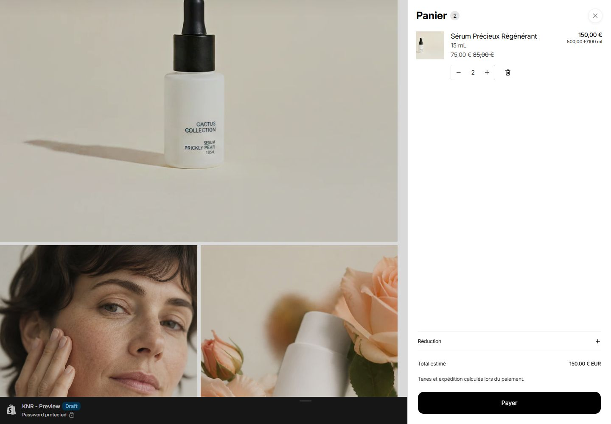
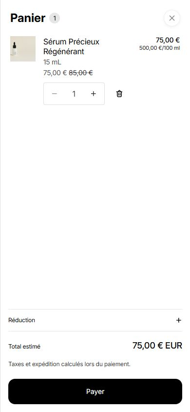
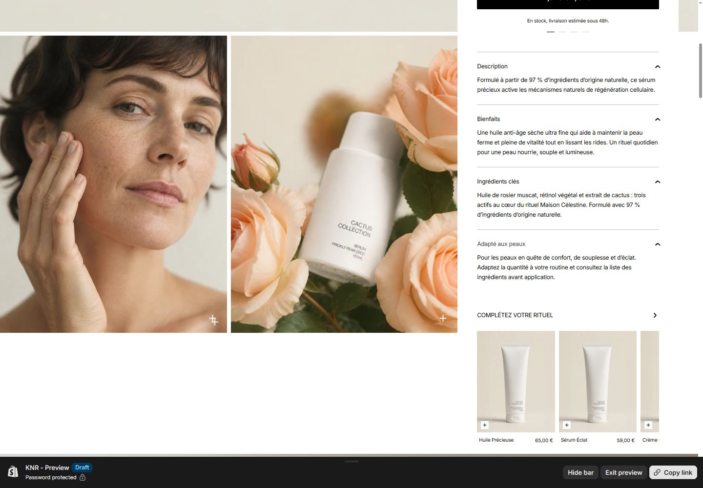

# Retours de revue du candidat

## 1. Le panier comprime la page au lieu de la recouvrir

**23 octobre 2026 — corrigé sur le thème de brouillon 189290447076.**

Le comportement desktop d'Horizon 4.3.0 réserve une colonne au tiroir. Le défaut signalé a été reproduit : sur une fenêtre de 1 864 px, le conteneur de page passait à 1 384 px, avec une marge de 480 px. Le dialogue était non modal.

Sur le layout KNR, le panier utilise désormais le cycle modal natif à toutes les largeurs : panneau fixé au bord droit, fond atténué et page inactive derrière, verrouillage du défilement, fermeture par croix, Échap ou clic sur le fond, puis restitution du focus et de la position de lecture. À 1 440 px, le conteneur conserve exactement 1 440 px et le contenu 1 430 px, avant et après ouverture. La gouttière de défilement reste réservée pour éviter un déplacement de 10 px. Sur petit mobile, le panneau occupe la largeur disponible.

La fermeture et la navigation ne mémorisent plus le panier KNR comme une colonne ouverte. Les articles du panier restent gérés par Shopify ; un ajout de la variante 150 mL puis un rechargement ont été vérifiés. Le mode sidebar natif des autres layouts reste hors du périmètre de cette adaptation.

Le script `scripts/patch-cart-overlay.mjs`, appelé par l'assembleur, applique deux adaptations ciblées à la copie autorisée d'Horizon : `assets/theme-drawer.js` et `snippets/theme-drawer.liquid`. Il vérifie les points d'application et échoue si le contrat source attendu a changé. Le dépôt ne contient pas de copie complète de ces fichiers natifs. Le CSS propre au layout KNR fournit le repli du jeton de couleur de fond et réserve la gouttière ; la préférence de mouvement réduit est respectée.

### Vérifications effectuées

- Panier vide, puis ajout de chacun des deux formats ; ouverture automatique en modal.
- Deux unités de 15 mL : 150 € ; ajout d'une unité de 150 mL : total 300 €.
- Fermeture par Échap et retour du focus au déclencheur ; Tab avance dans les commandes du panier.
- Clic sur le fond : fermeture et position de lecture conservée à 190 px.
- Suppression du dernier article : état vide, compteur à zéro, fermeture et déverrouillage du défilement après la transition native de section.
- Trois cycles d'ouverture/fermeture successifs ; aucune largeur réservée après fermeture.
- Mode de mouvement réduit : aucune animation de tiroir ; fermeture fonctionnelle.
- Largeurs 320, 375, 390, 768, 1 024 et 1 440 px : aucune compression du conteneur ni débordement horizontal du tiroir ; bouton Payer dans la fenêtre. Les changements de largeur avec le panier ouvert conservent son état modal.
- Assemblage, contrôles de syntaxe/contenu/formatage et Theme Check : 0 erreur, 2 avertissements natifs Horizon inchangés. Tests navigateur sous Chrome ; aucun nouveau résultat Safari/iOS revendiqué.

Les observations sont prises après les animations du tiroir et les transitions natives de mise à jour de section. Les premières lectures effectuées pendant ces transitions ne sont pas retenues comme états finaux.

[Mesures et interactions](final-validation/cart-overlay/checks.json) · [avant correction](final-validation/cart-overlay/before-desktop.png)

Le thème reste non publié. Aucun commit ni envoi de candidature.

## 2. Fermer l’image agrandie par un clic à l’extérieur

**23 octobre 2026 — corrigé sur le thème de brouillon 189290447076.**

Le défaut a été reproduit : le clic sur le fond atténué laissait le dialogue ouvert. La galerie utilise désormais l’utilitaire natif Horizon `isClickedOutside` pour fermer le dialogue uniquement lorsque le clic se situe à l’extérieur de ses limites. Cliquer sur l’image ou dans le cadre conserve le dialogue ouvert. L’écouteur suit le cycle de vie du composant et est libéré lors de son remplacement dans l’éditeur.

Vérifié dans Chrome à 1 440 px et en émulation mobile à 390 px : clic sur l’image sans fermeture, fermeture par le fond, croix et Échap, puis retour du focus au bouton de la galerie. Les ouvertures successives fonctionnent. Les contrôles JavaScript, contenu et formatage passent. Aucun changement de style, de contenu ou de publication.

[Résultats des interactions](final-validation/lightbox-dismissal/checks.json) · [dialogue desktop](final-validation/lightbox-dismissal/desktop-open.png) · [dialogue mobile](final-validation/lightbox-dismissal/mobile-open.png)

## 3. Les images s’allongent à l’ouverture des détails produit

**23 octobre 2026 — corrigé sur le thème de brouillon 189290447076.**

La galerie secondaire utilisait `height: 100%` dans une ligne de grille dimensionnée aussi par le panneau produit. À 1 440 px, ouvrir les quatre accordéons faisait passer cette galerie de 617 à 785,39 px et modifiait les recadrages.

La galerie garde désormais sa hauteur de composition : 617 px sur grand écran, 580 px entre 750 et 1 100 px, avec alignement en haut de la ligne. La ligne et le panneau continuent de grandir avec leur contenu ; aucun texte n’est masqué. L’espace supplémentaire se trouve sous les images au lieu de les étirer. La galerie principale et le comportement mobile restent inchangés.

Vérifié à 320, 390, 768, 1 024, 1 440 et 1 920 px : mêmes dimensions d’images avant/après ouverture des quatre détails, aucun débordement horizontal. À 1 440 px, fermeture de tous les détails puis réouverture de Description au clavier : dimensions toujours identiques. Contrôles de syntaxe/contenu/formatage réussis ; Theme Check : 0 erreur, 2 avertissements natifs Horizon inchangés.

[Mesures avant/après](final-validation/accordion-gallery/checks.json) · [avant correction](final-validation/accordion-gallery/before-expanded.png)

Le thème reste en brouillon, sans publication ni commit.

## 10. Survols des accordéons et des notes affinés

**23 octobre 2026 — révision demandée pendant la revue.** Le fond coloré au survol est retiré des accordéons produit, FAQ et menus mobiles du pied de page, ainsi que des lignes de répartition des notes.

Les titres d'accordéon reçoivent un soulignement de 1 px dans la teinte d'accent existante et leur chevron se déplace de 2 px. Son orientation continue d'indiquer uniquement l'état ouvert/fermé. Dans les notes, seule la portion déjà remplie de la barre passe du sable à l'accent ; le nombre devient noir avec un soulignement fin. La longueur de la barre et sa valeur restent inchangées. Aucun fond de ligne, nouvel élément visible, changement de taille ou déplacement du texte.

La modification utilise uniquement le CSS existant, avec une transition de 180 ms. Les règles de survol restent réservées à une souris/pointeur fin. En mouvement réduit, le chevron reste immobile et les retours de couleur sont immédiats. Les contours de focus clavier sont conservés.

Vérifié dans Chrome à 1440 px : transparence des fonds, dimensions identiques au repos et au survol pour les détails produit et les notes, soulignement des FAQ, ouverture/fermeture à la souris et avec Entrée. Le filtre quatre étoiles affiche deux avis et garde le focus sur la note. Tab affiche le contour de 2 px sur la note suivante. À 390 px, le menu de pied de page répond à la souris ; en émulation tactile, les survols restent inactifs, le détail Bienfaits s'ouvre et se referme, les filtres fonctionnent sans contour forcé sur Filtrer. Aucun débordement horizontal observé. Le filtre et les états ouverts sont rétablis, puis les émulations temporaires sont retirées.

`npm run check` réussit ; Theme Check : 0 erreur et 2 avertissements natifs Horizon inchangés. Les cinq fichiers concernés sont envoyés uniquement au thème de brouillon. Aucun nouveau relevé PageSpeed pour ce changement CSS ciblé ; les scores précédents restent datés de leurs audits. Aucun commit ni publication.

[Relevés](final-validation/hover-refinement/checks.json) · [accordéon produit](final-validation/hover-refinement/product-hover.png) · [FAQ](final-validation/hover-refinement/faq-hover.png) · [notes](final-validation/hover-refinement/rating-hover.png) · [mobile](final-validation/hover-refinement/mobile-ratings.png).

## 4. Donner une action claire à la flèche du rituel et aux boutons +

**23 octobre 2026 — corrigé sur le thème de brouillon 189290447076.**

La flèche du titre est désormais un lien vers **Collection Cactus**. Sa destination est personnalisable via un sélecteur de collection dans la section produit. Le défilement horizontal des cartes reste disponible au toucher et au clavier.

Chaque **+** des trois recommandations soumet un formulaire produit natif, amélioré par le même traitement Ajax que l’achat principal : quantité minimale de la variante, requête localisée, réponse Shopify confirmée, mise à jour du compteur et du tiroir natif. L’image et le nom conservent leur lien vers la fiche produit. Les boutons ont un nom accessible incluant le produit et une cible de 24 × 24 px ; le pictogramme original de 16 px conserve sa position.

Les ajouts simultanés sont bloqués pendant la requête. Le bouton actif affiche un état de chargement ; les erreurs s’affichent dans la carte et permettent une nouvelle tentative. Avant l’ouverture du tiroir, le bouton est réactivé et reçoit le focus pour que la fermeture du dialogue le restitue correctement. Pour une future recommandation à plusieurs variantes ou nécessitant un abonnement, le lien mène au choix des options ; les produits simples indisponibles ne peuvent pas être ajoutés.

### Vérifications effectuées

- Flèche : navigation effective vers la collection, titre « Collection Cactus » et produits présents.
- Huile Précieuse, Sérum Éclat et Crème Régénérante : ajout de chacun sans quitter la fiche, compteur et total conformes, tiroir modal ouvert.
- Ajout de Sérum Éclat au clavier ; Échap ferme le tiroir et rend le focus au bouton + utilisé.
- Requête d’ajout bloquée temporairement dans l’onglet de test : message d’erreur, panier inchangé, boutons réactivés. Blocage retiré ensuite.
- Nouvelle tentative sur Crème Régénérante par double clic : un seul ajout, 85 €.
- Achat principal 150 mL : ajout de la bonne variante, 150 €, après les modifications du traitement partagé.
- Mobile 390 px : ajout rapide, tiroir, suppression, boutons 24 × 24 px et aucune largeur de page excédentaire.
- Panier initial de deux sérums 15 mL à 150 € préservé après suppression des seuls ajouts de recette.
- Contrôles JavaScript, contenu, formatage et Theme Check : 0 erreur, 2 avertissements natifs Horizon inchangés. Aucun nouveau résultat Lighthouse/Safari revendiqué.

Lors du retour navigateur depuis la collection, Shopify a réaffiché une ancienne version hors aperçu. Les tests suivants ont rouvert explicitement le lien du thème de brouillon. Il s’agit du contexte de prévisualisation, pas d’une redirection provoquée par l’ajout Ajax.

[Résultats détaillés](final-validation/upsell/checks.json) · [panier desktop](final-validation/upsell/desktop-cart.png) · [panier mobile](final-validation/upsell/mobile-cart.png)

Le thème reste non publié ; aucun commit ni envoi de candidature.

## 5. Le clic sur les étoiles déplace le focus vers Filtrer

**23 octobre 2026 — corrigé sur le thème de brouillon 189290447076.**

Le gestionnaire des étoiles appelait explicitement `focus()` sur le sélecteur invisible. Son libellé recevait alors le contour de focus. Cet appel a été retiré : la note choisie filtre les avis, synchronise le sélecteur et annonce le nombre de résultats sans déplacer le focus. Les boutons exposent aussi leur état sélectionné via `aria-pressed`.

Les contours du libellé Filtrer et du comparateur avant/après suivent désormais `:focus-visible`, au lieu de tout focus reçu à la souris. Les indicateurs clavier restent présents ; aucun retrait global des contours n’a été effectué.

La revue a révélé un second défaut : une activation clavier de Charger plus perdait le focus lorsque le bouton disparaissait. Elle place maintenant le focus sur le titre du premier avis révélé, sans ajouter ces titres à l’ordre de tabulation ni déplacer le focus lors d’un clic souris. Les retours de focus des dialogues utilisent `preventScroll`. Le résumé d’erreur serveur du formulaire de contact reçoit `tabindex="-1"` pour permettre le focus déjà prévu par le composant.

### Vérifications effectuées

- Chrome desktop 1 440 px : clics sur 5, 4 et 3 étoiles, y compris zéro résultat ; focus conservé sur la note cliquée, aucun contour autour de Filtrer, sélection et annonce cohérentes.
- Mobile 390 px : clic sur 4 étoiles, deux avis affichés, aucune activation du contour de Filtrer.
- Activation clavier d’une note : indicateur sur cette note. Tab depuis Poser une question : focus et contour visibles sur Filtrer.
- Charger plus au clavier : six avis affichés, focus sur « Une texture soyeuse », premier nouvel avis.
- Formulaires Avis et Question : ouverture, Tab vers le nom, Échap, retour au déclencheur et position de défilement conservée.
- Comparateur : aucun contour au clic souris ; contour clavier et progression de 50 à 51 avec Flèche droite.
- Témoignages, accordéon produit, FAQ et accordéon mobile du pied de page : focus conservé sur la commande activée.
- Galerie et panier : fermeture par Échap et retour au déclencheur. Menu mobile : Tab avance dans les liens, Échap rend le focus au bouton du menu.
- Lien d’évitement : focus sur MainContent. Newsletter vide : la validation native place le focus sur l’e-mail requis. Aucun formulaire ni message n’a été envoyé pour cette recette.
- Contrôles JavaScript, contenu, formatage et Theme Check : 0 erreur, 2 avertissements natifs Horizon inchangés. Le rendu d’une nouvelle erreur serveur de contact et Safari/iOS n’ont pas été retestés.

[Résultats détaillés](final-validation/focus/checks.json) · [clic desktop](final-validation/focus/desktop-rating-click.png) · [clic mobile](final-validation/focus/mobile-rating-click.png)

Le thème reste en brouillon, sans publication ni commit.

## 6. Animations discrètes et désactivables au défilement

**23 octobre 2026 — ajouté au thème de brouillon à la demande du candidat.**

Le réglage **Paramètres du thème → KNR · Apparence → Animer les contenus au défilement** permet de désactiver toutes les apparitions ajoutées. Il est enregistré à **activé** pour la revue. Les libellés et l’aide sont disponibles en français et en anglais.

Quinze éléments éditoriaux (titres, présentation des ingrédients et du résultat, cartes du rituel et du journal) utilisent un fondu et une translation verticale de 12 px, une seule fois par chargement. Durée de 400 ms sur ordinateur et 360 ms sur mobile. Les cartes desktop se décalent de 60 ms, jusqu’à 180 ms ; aucun retard supplémentaire sur mobile. Les contenus déjà visibles à l’initialisation restent stables. Aucune animation n’est appliquée au produit, aux boutons d’achat, aux formulaires ou aux sections entières.

Un seul `IntersectionObserver` déclenche les apparitions ; aucun écouteur de défilement supplémentaire, bibliothèque, parallaxe ou calque GPU permanent. Seules l’opacité et la transformation sont animées. Les classes temporaires disparaissent à la fin, et chaque élément est retiré de l’observation après son apparition. Un focus clavier interrompt immédiatement l’animation de la carte ciblée. Les observateurs et les écouteurs sont libérés à la déconnexion du composant.

Le contenu est visible par défaut, y compris sans JavaScript. `prefers-reduced-motion` désactive les animations en CSS et arrête l’observateur en JavaScript, y compris lors d’un changement de préférence pendant la visite. Dans l’éditeur, `request.design_mode` exclut ce composant afin que la sélection et le rechargement des sections restent statiques.

### Vérifications effectuées

- Interrupteur Shopify désactivé, enregistré et aperçu rechargé : aucun contrôleur ni cible animée. Réactivation enregistrée, confirmée dans l’aperçu et dans les données du thème récupérées par CLI.
- Chrome 1 440 px : animation effective des trois cartes du rituel, 400 ms, retards de 0/60/120 ms. Après lecture : opacité 1, aucune transformation résiduelle ; revenir sur la section ne relance pas l’effet.
- Mobile émulé 390 px : durée effective 360 ms, retard nul. Défilement horizontal du rituel : la troisième carte apparaît à son entrée, sans débordement de page.
- Réduction des animations activée pendant la visite, puis dès le chargement : contenus immédiatement visibles, aucune animation persistante ou déclenchée au défilement.
- Navigation clavier dans les actualités : lien actif visible, contour clavier conservé, opacité 1 et transformation absente.
- JavaScript désactivé dans l’onglet de test : cartes et formulaire produit présents, visibles, sans débordement. JavaScript réactivé ensuite.
- Largeurs 320, 375, 390 et 1 440 px : aucune cible animée dans le produit, aucun débordement horizontal de page.
- Éditeur ouvert sur `knr-serum`, interrupteur actif et sauvegarde terminée ; capture conservée. L’inspection DOM de son iframe imbriquée n’a pas abouti ; l’exclusion en mode éditeur a été vérifiée dans le code Liquid.
- Syntaxe JavaScript, contenus, formatage et Theme Check : 0 erreur, 2 avertissements natifs Horizon inchangés. La console de test signale des échecs réseau de télémétrie Shopify lors des rechargements ; aucune erreur du module KNR relevée dans les journaux consultés.

Ces contrôles mobiles utilisent l’émulation Chrome, sans nouvelle mesure de fréquence d’images ni test Safari/iPhone réel. Les scores PageSpeed précédents n’ont pas été remesurés.

[Résultats détaillés](final-validation/motion/checks.json) · [réglage enregistré](final-validation/motion/shopify-setting.png) · [cartes mobile](final-validation/motion/mobile-usage.png)

Références techniques : [Intersection Observer](https://developer.mozilla.org/en-US/docs/Web/API/Intersection_Observer_API), [préférence de mouvement réduit](https://developer.mozilla.org/en-US/docs/Web/CSS/Reference/At-rules/@media/prefers-reduced-motion).

Le thème reste en brouillon. Aucun commit, publication ou envoi de candidature.

## 7. Survols cohérents sur toute la fiche

**23 octobre 2026 — ajouté au thème de brouillon à la demande du candidat.**

La revue couvre tous les types de commandes de la page : annonce, logo, navigation et icônes, galerie et agrandissement, formats et achat principal/flottant, accordéons, recommandations et ajout rapide, liens du rituel, comparateur, témoignages, avis et filtres, actualités, newsletter, formulaires en dialogue, pied de page et panier. Les contenus informatifs sans action restent statiques.

Le vocabulaire visuel utilise les jetons configurables existants : soulignement fin pour les liens, fonds papier/sable pour les commandes secondaires et champs, encre légèrement réchauffée pour les boutons principaux. Les icônes blanches de l’en-tête reçoivent un halo discret de 28 px. Les flèches se déplacent de 2 px et les images réellement cliquables s’agrandissent de 2,5 % dans leur cadre, sans modifier la grille ou le recadrage au repos. Les textes restent opaques ; les tailles et espacements de la maquette au repos sont conservés.

Durée commune de 180 ms, 300 ms pour le zoom d’image. Les règles sont conditionnées par `(hover: hover) and (pointer: fine)`. En mouvement réduit, les couleurs changent immédiatement, sans zoom, déplacement ni transition. Les boutons personnalisés indisponibles ou en chargement sont exclus des règles de survol. Les indicateurs de focus clavier restent indépendants du survol.

Les utilitaires partagés résident dans `knr-base.css` ; les détails propres à un composant restent dans le `` de sa section. L’adaptation visuelle des commandes natives du panier est limitée à `.knr-page #cart-drawer`. Aucun JavaScript ni aucune dépendance supplémentaire n’a été ajouté. Les survols restent indépendants de l’interrupteur des apparitions au défilement.

### Vérifications effectuées

- Chrome 1 440 px : survols réels par déplacement du pointeur sur les liens, boutons, images, formats, accordéons, comparateur, flèches, étoiles, filtre, pagination, champs, newsletter, pied de page et panier. Les dimensions mesurées avant/après restent identiques.
- Images de recommandations, galerie secondaire et actualités : agrandissement effectif à 1,025 dans le cadre ; flèches précédent/suivant : déplacement de −2/+2 px.
- Dialogues Avis et Galerie : fermeture survolée et fonctionnelle par Échap. Champs Nom, Note, Message et bouton Envoyer inspectés sans soumettre de formulaire.
- Panier : fermeture, quantité, suppression, image, titre, réduction, champ du code, bouton Appliquer et bouton Payer survolés sans achat ni changement de contenu. Les deux unités de 15 mL présentes avant la recette restent dans le panier.
- Clic sur 4 étoiles : deux avis, focus conservé sur la note, aucun contour indésirable autour de Filtrer ; filtre rétabli ensuite.
- Clavier : contour de 2 px sur Ajouter au panier ; menu mobile ouvert, Tab vers Produits, lien avec focus visible, Échap fonctionnel.
- Mobile tactile émulé 390 px : les règles de survol ne s’activent pas sur le bouton d’achat, le format, l’image d’article, la flèche ou le menu. Sélection 150 mL : 150 €, puis retour à 15 mL. Aucun débordement de page à 320, 390 ou 1 440 px.
- Fenêtre étroite 390 px avec souris : halo de menu, liens et fermeture du menu, lien Lire plus et accordéon du pied de page fonctionnent au survol.
- Mouvement réduit : image sans agrandissement, flèche sans translation, transition à 0 s ; retour de couleur du bouton conservé.
- Contrôles de syntaxe, contenu et formatage réussis ; Theme Check : 0 erreur, 2 avertissements natifs Horizon inchangés.

Les premiers relevés des contrôles de pays étaient masqués par la barre de prévisualisation Shopify ; ils ont été refaits après masquage de cette barre dans l’onglet de test. Deux relevés initiaux ont échantillonné une transition de sortie ; les relevés « settled » confirment les états au repos et au survol. Les résultats bruts conservent ces étapes. Les réseaux sociaux n’étant pas renseignés, leur utilitaire a été vérifié dans le code. Les exclusions indisponible/chargement ont été vérifiées dans les sélecteurs CSS, sans modifier le stock. Aucun nouveau score Lighthouse ni résultat Safari/iPhone réel n’est revendiqué.

[Résultats détaillés](final-validation/hover/checks.json) · [survol d’une carte Actualités](final-validation/hover/news-hover.png)

Le thème reste en brouillon. Aucun commit, publication ou envoi de candidature.

## 8. Carrousel de livraison et réassurance

**23 octobre 2026 — ajouté au brouillon à la demande du candidat.** Les quatre traits deviennent des commandes de sélection pour quatre messages éditables. Rotation de 4 secondes par défaut, réglable de 4 à 12 secondes ou désactivable dans **KNR · Produit**. Les quatre traits constituent les seules commandes visibles. Clavier/toucher, suspension au focus/survol, mouvement réduit, disponibilité de variante, arrêt hors écran et nettoyage des ressources sont pris en charge.

La recette, les réglages, les preuves et les limites sont consignés dans [CARROUSEL-REASSURANCE.md](CARROUSEL-REASSURANCE.md). Les conditions commerciales restent celles du jeu de démonstration. Aucun commit ni publication.

## 9. Image principale sans agrandissement

**23 octobre 2026 — correction demandée pendant la revue Figma.** Le bouton « + » superposé à l’image principale est supprimé, ainsi que la zone de clic invisible couvrant cette image et ses règles de survol/focus. Les images du carrousel principal ne déclenchent plus de fenêtre d’agrandissement et gardent un curseur normal. Les deux images secondaires conservent leurs commandes d’agrandissement prévues dans la composition. La flèche et la navigation tactile/clavier du carrousel mobile restent disponibles.

Vérification dans Chrome à 1440 et 390 px : aucun contrôle de zoom dans le hero, clic/toucher sur la première image sans ouverture du dialogue, deuxième image mobile également non interactive. La flèche mobile déplace la galerie de 390 px et la flèche gauche au clavier revient à la première image. Le zoom d’une image secondaire s’ouvre et se ferme par Échap. Aucun débordement à 320, 390 ou 1440 px. Contrôles JS/contenu/format réussis ; Theme Check : 0 erreur, 2 avertissements natifs Horizon inchangés. Aucun nouveau score de performance n’est revendiqué.

[Relevés](final-validation/hero-static/checks.json) · [ordinateur](final-validation/hero-static/desktop.png) · [mobile](final-validation/hero-static/mobile.png)

Le thème reste en brouillon, sans publication ni commit.

## 11. Focus des champs sans encadrement noir

**23 octobre 2026 — correction demandée pendant la revue.** Le champ e-mail et le sélecteur de pays recevaient un contour noir après un clic, car le navigateur peut appliquer `:focus-visible` aux champs de saisie même à la souris. Le focus des champs utilise désormais un soulignement intérieur de 2 px, dans une teinte chaude issue de l’accent et de l’encre du thème. Les dimensions et le rendu au repos restent identiques.

Cette règle commune couvre les champs texte, e-mail, nombre, listes et zones de message de la fiche personnalisée et du panier. Le libellé du filtre des avis est souligné lorsqu’il reçoit le focus. Les boutons, liens, accordéons et le comparateur conservent leurs indicateurs clavier. En mode couleurs forcées, un contour de 2 px dans la couleur système `Highlight` remplace le soulignement pour rester visible. Aucun JavaScript ou chargement supplémentaire.

### Vérifications effectuées

- Chrome desktop 1 864 px : e-mail de newsletter et pays à la souris et au clavier, sans encadrement noir ni changement de dimensions. Le bouton d’inscription garde son indicateur clavier.
- Dialogues Avis et Question : nom, e-mail, note et message vérifiés. Une tentative d’envoi vide place correctement le focus sur le nom requis ; aucun message transmis.
- Newsletter : une adresse volontairement invalide déclenche la validation native et le focus sur le champ ; valeur ensuite effacée, aucune inscription envoyée.
- Filtrer : libellé souligné de 2 px, sans contour, sélection finale « Tous les avis ».
- Panier : quantité et code de réduction avec le même focus, sans modification du panier de deux unités de 15 mL (150 €).
- Mobile tactile émulé 390 px : e-mail et pays soulignés, sans débordement horizontal. Le bouton Appliquer a enregistré France/EUR pendant cette recette ; la page produit est revenue normalement. Aucune commande passée.
- Couleurs forcées émulées : contour système de 2 px effectivement observé sur l’e-mail, puis émulation désactivée.
- Le lien de recherche ouvre la page native de recherche ; les styles de cette page d’accompagnement restent ceux du thème natif.
- Contrôles JS, contenu et formatage réussis ; Theme Check : 0 erreur, 2 avertissements natifs Horizon inchangés.

Les onglets mobiles et de couleurs forcées ont été fermés après la recette. Une observation initiale intitulée « mobile-newsletter » concernait le corps de l’onglet desktop ; les observations « mobile-newsletter-verified » et « mobile-country-verified » la remplacent. Aucun nouveau résultat Lighthouse ou Safari/iPhone réel n’est revendiqué.

[Relevés](final-validation/form-focus/checks.json) · [newsletter](final-validation/form-focus/newsletter-focus.png) · [pays](final-validation/form-focus/country-focus.png) · [newsletter mobile](final-validation/form-focus/mobile-newsletter-focus.png) · [pays mobile](final-validation/form-focus/mobile-country-focus.png)

Le thème reste en brouillon, sans publication ni commit.

## 12. Bas du pied de page conforme à la composition Figma

**25 octobre 2026 — correction demandée pendant la revue.** Références : [ordinateur 720:1315](https://www.figma.com/design/gkR3Ew3ksO4sd8AmoMeAHB?node-id=720-1315) et [mobile 653:1667](https://www.figma.com/design/gkR3Ew3ksO4sd8AmoMeAHB?node-id=653-1667).

Le bouton Appliquer disparaît après initialisation du composant. Le changement de pays ou de langue soumet le formulaire natif Shopify et conserve la fiche produit. Un texte destiné aux lecteurs d’écran annonce le rechargement ; les indicateurs de focus existants restent visibles. Sans JavaScript, le bouton demeure disponible pour garder le formulaire utilisable. Les écouteurs utilisent le cycle de vie commun du composant, avec nettoyage à la déconnexion et réinitialisation lors du remplacement des sections.

Les quatre URL auparavant vides sont renseignées dans les réglages du pied de page : Facebook, Instagram, TikTok et LinkedIn, dans cet ordre. Elles pointent vers les accueils des réseaux, comme demandé, et restent éditables. Les quatre SVG locaux sont identiques octet pour octet aux exports Figma récupérés pour cette revue ; dimensions 20 × 20 px et espace de 16 px. Les chevrons d’origine sont réutilisés à leurs dimensions intrinsèques, sans modification des fichiers. Le texte France (€), la capitale de Français, le copyright complet et les marges de 40 px suivent les références.

### Vérifications effectuées

- Chrome 1 440 px : barre du bas de 100 px, marge intérieure de 40 px, espace de 16 px ; quatre images chargées en 20 × 20 px, destinations et noms accessibles vérifiés. Appliquer absent de l’affichage.
- Chrome 390 px : barre de 164 px, trois rangées centrées, mêmes icônes et espacements. À 320 px, le copyright passe sur deux lignes sans débordement ; barre de 180 px.
- Pays : France vers États-Unis par sélection seule, rechargement manuel confirmant la persistance, puis retour à France par sélection seule. La langue française et la vue du produit sont conservées.
- Clavier : Tab atteint Instagram avec un contour visible ; Maj+Tab depuis Facebook atteint la langue avec le soulignement chaud, sans encadrement noir.
- JavaScript désactivé dans un onglet isolé : bouton Appliquer visible, champs natifs présents, formulaire dirigé vers `/localization`, texte d’application automatique masqué. JavaScript réactivé et onglet fermé après contrôle.
- Aucun changement de stock, de panier, de mot de passe, de thème publié ou de commit. Les données du thème ont été récupérées avant modification ; seuls les liens sociaux et le copyright ont changé dans ses réglages.
- Contrôles JS, contenu et formatage réussis ; Theme Check : 0 erreur, 2 avertissements natifs Horizon inchangés. Aucun nouveau score Lighthouse ni test Safari/iPhone réel.

La première observation desktop précède le défilement vers les images chargées à la demande ; les observations `desktop-1440-visible` et `desktop-final` confirment leur chargement. La vérification des destinations sociales porte sur les liens rendus ; aucune connexion ou interaction avec un compte social n’a été effectuée.

[Relevés](final-validation/footer-bottom/checks.json) · [ordinateur](final-validation/footer-bottom/desktop.png) · [mobile](final-validation/footer-bottom/mobile.png)

Le thème reste en brouillon, sans publication ni commit.

## 13. Libellés du pied de page repris exactement de Figma

**25 octobre 2026 — correction de contenu demandée pendant la revue.** Comparaison du [bloc Figma ordinateur 720:1232](https://www.figma.com/design/gkR3Ew3ksO4sd8AmoMeAHB?node-id=720-1232) avec les trois menus et le bloc de certification rendus dans la boutique.

| Avant | Texte exact de Figma |
| --- | --- |
| CGV | Conditions générales de vente |
| Voir les engagements | Voir le certificat |
| Livraison & retours | Livraison & retour |
| Paramètres des cookies | Paramètre des cookies |

Les trois titres de menus, leurs quatorze liens, le titre et le paragraphe À propos, la mention de certification et son lien ont été comparés. Les autres textes de ce bloc étaient déjà identiques. Figma contient bien « Voir le certificat », sans e après Voir.

Les menus `legal-transparence` et `service-client` ont été enregistrés dans Shopify. Le libellé de certification a été modifié dans les paramètres du thème de brouillon ; le jeu de réglages local et les archives ont été synchronisés. Aucun remplacement de texte dans Liquid : le contenu reste éditable. Les destinations des liens sont conservées. Aucun document de certification n’ayant été fourni, « Voir le certificat » conserve la page de contexte `/pages/nos-engagements` ; aucun certificat fictif n’a été créé.

Vérification de la fiche de brouillon après rechargement à 1 440 px, puis ouverture du menu légal à 390 px : textes présents, aucun débordement horizontal, certificat affiché en 47 × 56 px. Le contrôle de contenu est réussi. Aucun changement de code CSS/JS/Liquid, donc les résultats de Theme Check et des contrôles de code du correctif précédent restent applicables ; aucun nouveau résultat de performance n’est revendiqué.

[Relevés](final-validation/footer-copy/checks.json) · [ordinateur](final-validation/footer-copy/desktop.png) · [menu mobile](final-validation/footer-copy/mobile.png) · [menus éditables](../content/footer-navigation.json)

Le thème reste en brouillon, sans publication ni commit. Les menus Shopify sont des ressources partagées de la boutique ; seule leur formulation a changé.

## 14. Contrôle de tous les textes, section par section

**25 octobre 2026 — audit demandé pendant la revue.** Les 279 calques des références ordinateur et mobile ont été rapprochés des contenus rendus dans les douze sections. Après normalisation des espaces, apostrophes et capitales d’affichage : 176 correspondances, 86 occurrences de corrections convenues conservées, 17 variantes de dessin masquées non affichées, aucun écart de formulation inexpliqué.

Le fil d’Ariane affiche maintenant « Soins anti-âge / Collection Cactus ». Quatre réponses FAQ reformulées ont été remplacées par les textes complets de la référence ordinateur, y compris leurs dernières phrases. Les prix cohérents, calculs unitaires, avis de démonstration, corrections de français et contenus ordinateur communs au mobile sont conservés. Les réponses FAQ restent éditables dans les blocs de section ; le fil d’Ariane conserve des liens Shopify et une traduction de son premier libellé.

Comparaison des contenus à 1440 et 390 px, ouverture de toutes les réponses sans texte coupé ni débordement, vérification mobile des deux variantes et de leurs prix, retour à 15 mL et aux accordéons initiaux. Le premier lien du fil d’Ariane ouvre le catalogue Produits. Contrôles de code/contenu/format réussis ; Theme Check : 0 erreur et 2 avertissements natifs Horizon inchangés. Aucun nouveau score de performance.

[Audit détaillé](AUDIT-TEXTES.md) · [Comparaison par calque](final-validation/text-audit/comparison.json) · [FAQ ordinateur](final-validation/text-audit/desktop-expanded-faq.png) · [FAQ mobile](final-validation/text-audit/mobile-expanded-faq.png)

Le thème reste en brouillon, sans publication ni commit.

## 15. Mesures visuelles finales desktop et mobile

**25 octobre 2026 — contrôle demandé pendant la revue.** Comparaison des douze sections avec les frames Figma 720:729 et 653:1125 : espacements, tailles et interlignages, couleurs, alignements, images et icônes. Quatre ajustements : largeur du pays et placement de Français, espacement uniforme des cartes de réassurance, dimensions intrinsèques des chevrons, ratio réservé du logo de pied de page. Les contenus et prix convenus sont conservés.

26 captures finales à 1440 et 390 px ; contrôle des limites de section aux sept largeurs, sans débordement. Les douze accordéons ont été testés au clavier. Le formulaire de localisation a été vérifié avec sauvegarde et rechargement, retour à France, focus clavier/couleurs forcées et fallback sans JavaScript. Contrôles de code réussis ; Theme Check : 0 erreur, 2 avertissements Horizon existants. Aucun nouveau score Lighthouse ni essai Safari réel.

[Audit détaillé et écarts de contenu expliqués](AUDIT-VISUEL-FINAL.md) · [Relevés](final-validation/visual-20261025/checks.json) · [Desktop](final-validation/visual-20261025/desktop-footer.png) · [Mobile](final-validation/visual-20261025/mobile-footer.png)

Le thème reste en brouillon, sans publication ni commit.

## 16. Annonce, prix unitaire et image de l’achat flottant

**25 octobre 2026 — précisions et correctif après revue du candidat.**

- L’annonce Figma contient le lien de remplissage « consectetur. ». Le candidat a confirmé conserver « En savoir plus ». La destination Livraison et retours reste inchangée.
- La ligne de prix unitaire est intentionnelle : 75 € pour 15 mL équivaut à 500 € / 100 mL. La maquette indique 75 € / 100 mL, ce qui est incohérent avec son prix et son volume. Les mesures natives Shopify restent la source commune ; 150 mL à 150 € donne 100 € / 100 mL.
- La vignette de la barre flottante utilisait la dernière image produit. Cet écart a été manqué dans l’audit précédent. Elle utilise maintenant le tube blanc exact fourni dans le calque Figma 720:878, avec son cadrage : 104 × 104 px, image ajustée en couverture et position verticale à 69,23 %. Le fichier original déjà présent correspond octet pour octet au nouvel export Figma ; aucun nouvel asset nécessaire.

Le nouveau réglage **KNR · Produit → Image de la barre d’achat flottante** permet de la remplacer sans code. Si le réglage est vide, le thème utilise l’image principale du produit, indépendamment de l’ordre des médias. La configuration de la boutique référence le fichier Shopify existant ; le jeu d’installation utilise son nom local normalisé. Le tube est repris comme illustration de la maquette ; la galerie et les variantes conservent leurs médias de sérum convenus.

La vignette chargée et son cadrage ont été vérifiés sur la boutique de brouillon. Les deux variantes sélectionnées depuis la barre synchronisent le prix principal, le prix flottant et le prix unitaire ; retour à 15 mL. À 390 px, la barre reste masquée conformément à la composition mobile, sans débordement. Contrôles de code/contenu/format réussis ; Theme Check : 0 erreur et 2 avertissements Horizon existants. Aucun nouveau résultat Lighthouse.

[Relevés](final-validation/sticky-image/checks.json) · [Barre corrigée](final-validation/sticky-image/floating-block.png)

Le thème reste en brouillon, sans publication ni commit. Aucun ajout au panier, changement de stock ou envoi de formulaire.

## 17. Habillage du panier cohérent avec la fiche produit

**25 octobre 2026 — demande du candidat.** Le panier natif utilise la fonte KNR Inter, des titres réguliers et noms de produits en capitales, les couleurs papier/sable/encre du thème, des contrôles fins et un bouton noir de 48 px avec rayon de 2 px. Les couleurs suivent les réglages existants. La superposition modale reste inchangée.

Recette des quantités, prix, panier mixte, suppression, panier vide, nouvel ajout, erreur de réduction, focus, survol, réduction des mouvements et couleurs forcées. Sept largeurs contrôlées ; à 320 × 568 px, les articles défilent et le paiement reste accessible. Un défaut natif de focus après suppression du dernier article a été corrigé dans l’assembleur, uniquement pour le panier modal KNR ; Fermer reçoit désormais le focus après le rendu serveur.

Le panier initial de deux unités de 15 mL à 150 € est restauré. Contrôles de code, assemblage neuf et syntaxe du composant natif généré réussis. Theme Check : 0 erreur, 2 avertissements Horizon existants. Aucun nouveau score Lighthouse ni essai Safari réel.

[Rapport et captures](PANIER-STYLE.md) · [Preuves](final-validation/cart-style/checks.json)

Le thème reste en brouillon, sans publication ni commit. Aucune commande passée.

## 18. Espacement mobile du lien Lire plus

**25 octobre 2026 — ajustement de maquette explicitement demandé par le candidat.** Le lien des cartes « Comment l’utiliser » était rapproché du paragraphe par une marge de −22 px. Avec le gap de 16 px de leur conteneur, cela donnait un écart de boîte de −6 px. Cette marge a été retirée : les trois liens disposent maintenant de **16 px** au-dessus, selon le même rythme que le reste des cartes.

Mesures sur la boutique de brouillon à 320, 375 et 390 px : 16 px sur chacune des trois cartes, sans débordement horizontal, mêmes libellés et destinations `/pages/le-rituel`. La hauteur mobile passe de 683,80 à 705,80 px ; cet écart volontaire avec Figma est consigné dans le journal des corrections. À 1440 px, les liens restent masqués et la section conserve sa hauteur de 834 px.

Contrôles de code/contenu/format réussis ; Theme Check : 0 erreur et 2 avertissements Horizon existants. Un seul fichier de section envoyé au thème 189290447076 non publié, sans suppression distante. Aucun changement de données, de panier, de JavaScript ou d’assets ; aucun nouveau score de performance.

[Relevés](final-validation/usage-link-spacing/checks.json) · [Avant](final-validation/usage-link-spacing/mobile-before.png) · [Après](final-validation/usage-link-spacing/mobile-after.png)

Le thème reste en brouillon, sans publication ni commit.

## 19. Dernière revue et préparation de la soumission

**25–26 octobre 2026.** Les nouvelles captures couvrent les douze zones desktop/mobile ; vingt-deux comparaisons Figma / Shopify ont été inspectées, ainsi que les seize séquences de la vidéo actualisée de 3 min 28 s. Les captures desktop du haut de page et des détails ont été reprises après chargement des images et alignement du défilement. Aucun nouveau correctif du thème requis.

Les variantes, le panier et son erreur Ajax, les images secondaires, le menu mobile, les accordéons, la comparaison clavier, les témoignages, les avis, les validations de formulaires, la localisation et les destinations ont été retestés. Les sept largeurs de 320 à 1920 px n’ont aucun débordement de document ou de section. Panier initial rétabli : deux flacons 15 mL, 150 €, pays France. Les détails figurent dans la [revue avant soumission](REVUE-AVANT-SOUMISSION.md).

Le package inclut les notes de remise françaises, le message Upwork à adapter et les étapes restantes après accord. Échéance calculée depuis la réception : 27 octobre à 14:55, heure de Tunis. Aucune publication, aucun commit, aucun envoi. Aucun nouveau score PageSpeed ni résultat iOS inventé.

## 20. Nouvelle passe PageSpeed sur le lien visiteur

**26 octobre 2026.** Le candidat a fourni un nouveau lien de partage. Trois analyses par profil ont été terminées : ordinateur 98, 96, 98 ; mobile 81, 90, 68. Médianes 98 et 81, sans résultat écarté. Le TBT mobile est faible et le CLS nul ; le délai de rendu du hero varie fortement. La cause n’est pas établie par ces mesures et les animations ne sont pas désignées comme responsables. Le point ouvert de performance mobile est ajouté à la remise, avec les [rapports et diagnostics complets](PERFORMANCE-PAGESPEED.md).

Aucune modification du code, des réglages, du stock ou du mot de passe. Le thème reste non publié ; zéro commit et aucune soumission. Les archives et le manifeste sont actualisés avec ces résultats.

## 21. Indisponibilité sur le lien visiteur depuis l’iPhone

**26 octobre 2026.** Le candidat a reproduit l’indisponibilité des deux tailles sur iPhone 16 Pro. Le stock était de 100 unités par taille ; les visiteurs hors des marchés France/États-Unis recevaient la région de repli. Le marché international seul et le système anticipé d’expédition ne suffisaient pas au panier : le refus se reproduisait avec Horizon inchangé.

La configuration finale utilise un marché international de recette et les profils d’expédition standards, avec une zone de 236 destinations hors États-Unis liée au lieu possédant le stock. Le tarif français de 5,90 EUR, gratuit dès 60 EUR, et les options US initiales sont conservés. Les variantes et l’ajout rapide ont produit les totaux serveur attendus (225 EUR pour les deux tailles, 290 EUR avec Huile Précieuse). Le candidat a confirmé les deux tailles et le panier sur iPhone après correction. [Détails et preuves](DISPONIBILITE-INTERNATIONALE.md).

Panier normal rétabli à deux 15 mL / 150 EUR / France ; panier visiteur isolé vidé. Aucun code, stock ou mot de passe modifié. Aucune commande, publication ni commit. Le contrôle iPhone est ciblé ; il ne certifie pas toute la page sous Safari. Les scores PageSpeed du matin précèdent cette correction administrative.

## 22. Menu mobile : focus tactile et ouverture/fermeture

**26 octobre 2026.** Le signalement iPhone montre un cadre noir autour de la croix lors de l’ouverture. La correction conserve le focus natif du dialogue et les indicateurs clavier, en masquant uniquement l’indication des contrôles de menu pour une activation tactile/souris. Entrée/sortie en translation de 280 ms et fondu du fond de 220 ms, désactivés avec réduction des mouvements. Aucun nouveau contrôle visible.

Les essais ont aussi corrigé un ancien événement `close` pouvant affecter une réouverture rapide et un décalage de largeur lié à la gouttière. Recette aux largeurs 320, 390, 402 et 430 px, clavier, touch après clavier, Échap, fond, réouverture rapide, réduction des mouvements et réinitialisation simulée du composant. Navigation desktop et panier revérifiés à 1440 px ; panier initial inchangé. [Détails et captures](MENU-MOBILE.md).

Deux fichiers de thème envoyés uniquement au brouillon 189290447076. Aucun changement de données, publication ou commit. Le retest du menu sur l’iPhone réel et une nouvelle mesure PageSpeed ne sont pas revendiqués.

## 23. Recommandations : cible tactile du « + »

**26 octobre 2026.** Le candidat signale l’ouverture de la page produit après un appui sur le « + » depuis l’iPhone. La cible de 24 px était adjacente au lien de l’image. Elle passe à 44 × 44 px, dans une couche distincte, avec la même icône Figma de 16 px et sans modifier le JavaScript.

Les trois appuis tactiles de contrôle utilisent la partie agrandie de la cible : Huile Précieuse, Sérum Éclat et Crème Régénérante s’ajoutent sans changement d’URL, y compris après le défilement des cartes. Total confirmé 359 EUR avec le panier initial ; ajout clavier supplémentaire confirmé, puis tous les produits de recette retirés. Quatre largeurs sans débordement ; panier initial deux 15 mL / 150 EUR / France. [Détails et preuve](AJOUT-RAPIDE-TACTILE.md).

Une section envoyée au brouillon non publié. Aucun commit, aucune commande et aucun changement de stock ou de réglage marchand. Retest iPhone du correctif et nouvelle mesure PageSpeed non effectués.

## 24. Transitions harmonisées des tiroirs

**26 octobre 2026.** À la demande du candidat, menu et panier utilisent une entrée de 320 ms, une fermeture de 240 ms et un fond de 220 ms. Le panier remplace son mouvement natif de position par une transformation ; un départ de fermeture capturé évite de repartir du début après interruption d’une entrée. Le correctif reste limité au panier KNR et reproductible par l’assembleur.

Réduction des mouvements, croix, fond, Échap, focus, entrée interrompue, réouverture pendant la sortie et stabilité de largeur vérifiés. Panier contrôlé jusqu’à 1920 px ; ajout rapide tactile revérifié, position de défilement conservée et panier initial restauré. [Détails et captures](TRANSITIONS-TIROIRS.md). Aucun nouveau score PageSpeed ni retest iPhone de ce réglage.

Quatre fichiers de thème envoyés au seul brouillon 189290447076. Aucun contenu marchand, stock ou mot de passe modifié, aucune publication, commande ou commit.

## 25. Galerie mobile : flèche précédente

**26 octobre 2026.** Le candidat demande explicitement de compléter la flèche suivante de Figma par une flèche précédente à gauche. Le SVG noir de 16 px est réutilisé à 180°, avec deux cibles tactiles invisibles de 44 px, sans déplacer le centre de l’icône droite. Navigation précédente/suivante commune, bouclage et clavier cohérents ; réduction des mouvements respectée.

Dix-sept relevés fonctionnels : deux sens, limites, Entrée/Espace, flèches clavier, événements tactiles, glissement, progression, réduction des mouvements et images/prix des deux tailles. Sept largeurs : boutons présents sous 750 px et masqués sur desktop, sans débordement. [Rapport et capture](GALERIE-MOBILE.md). L’écart approuvé est ajouté au journal de maquette.

Première image, 15 mL et panier initial rétablis. Aucun changement de prix, stock ou contenu marchand, aucun zoom ajouté au hero. Thème non publié, aucun commit ni commande. Retest iPhone et nouveau score PageSpeed du correctif non effectués.

## 26. Ouverture/fermeture des détails produit et de la FAQ

**26 octobre 2026.** Les neuf accordéons conservent `details`/`summary` et reçoivent une animation de réponse de 260 ms, en hauteur et opacité, avec chevron synchronisé. Les clics rapides repartent de la hauteur rendue ; la fin du mouvement rétablit les dimensions automatiques. Aucun changement de texte ou d’espacement au repos.

Contrôles : neuf cycles complets, espaces initiaux comparés à 1440 et 390 px, images secondaires stables à 609 px avec tous les détails ouverts, sept largeurs sans débordement, clavier/focus, réduction des mouvements, redimensionnement et réinitialisation simulée du composant. Repli natif vérifié par appui tactile après désactivation réelle de JavaScript. Les durées exécutées sont bien 260 ms après normalisation des unités CSS. [Rapport et captures](ACCORDIONS.md).

Quatre fichiers de thème envoyés au seul brouillon, dont un nouveau propriétaire de styles communs. Aucun contenu marchand, prix, stock ou mot de passe modifié ; aucun commit, publication ou commande. Les premiers états ouverts et le panier initial sont rétablis. Aucun nouveau résultat PageSpeed ou iPhone réel.

## 27. Panier : cadre après ouverture et retour tactiles

**26 octobre 2026.** Le candidat signale sur iPhone Chrome un cadre autour de la croix, puis du « + » restauré. Un composant invisible suit pointeur et clavier ; les styles retirent uniquement les cadres des contrôles de panier concernés en mode pointeur. Les mouvements de focus natifs, les cadres clavier et les champs soulignés sont conservés.

Dix-neuf relevés couvrent les deux déclencheurs, le retour du focus, Tabulation/Échap et le champ Quantité, à 390 px et au viewport ordinateur normal. **Le candidat a actualisé son iPhone et confirmé « Both are clear » pour les deux parcours.** [Rapport et capture](FOCUS-PANIER.md).

Les produits de recette sont retirés et le panier initial rétabli à deux 15 mL / 150 EUR / France. Trois fichiers envoyés au seul brouillon. Aucun changement de stock, prix ou contenu marchand ; aucun commit, publication ou commande. Aucun nouveau score PageSpeed.
